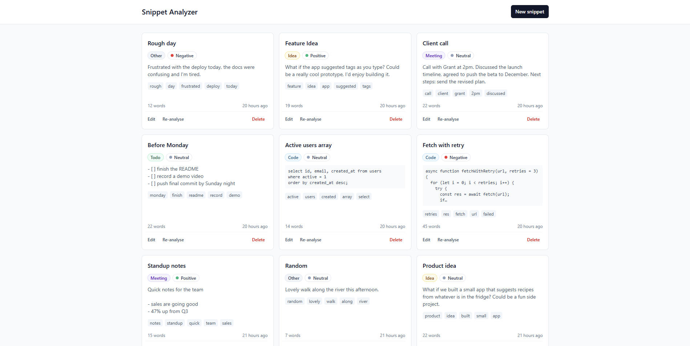

# Snippet Analyzer

A small full-stack app for saving text snippets (notes, code, todo lists, meeting notes) and tagging them automatically. Every time a snippet is created or its text changes, the server analyses it and stores a category (Idea, Code, Todo, Meeting or Other), a sentiment score and label, the top five keywords and a word count. The client is React + Vite + Tailwind, and the server is Express with SQLite.



## Prerequisites

- Node.js 22.12 or newer
- npm

That's all. SQLite ships inside `better-sqlite3`, so there's no database to install.

## Getting started

Run the server and the client in two terminals. The commands are the same in PowerShell and bash.

Terminal 1, the API on http://localhost:3001:

```sh
cd server
npm install
npm run dev
```

Terminal 2, the UI on http://localhost:5173 (or whichever port Vite prints):

```sh
cd client
npm install
npm run dev
```

Open http://localhost:5173 (or whichever port Vite prints). The Vite dev server proxies `/api` to port 3001, so the client needs no config and the server needs no CORS.

Notes:

- `.env` is optional. Every setting has a default in code. To override one, copy the example file in `server/`:
  - macOS/Linux: `cp .env.example .env`
  - PowerShell: `Copy-Item .env.example .env`
- The SQLite file is created on first run at `server/data/snippets.db`, along with the folder.
- `npm run dev` restarts on file changes. `npm start` runs the server without watching.

## Running tests

```sh
cd server
npm test
```

This runs 60+ Vitest tests:

- **Analyzer unit tests** (`tests/analyzer.test.js`): category detection, including the cases it should *not* match, sentiment with negation, keyword extraction, word count and the result shape.
- **API tests** (`tests/snippets.api.test.js`): Supertest against the Express app, covering CRUD, validation, when analysis re-runs, saving when the analyzer throws, malformed JSON and the generic 500. `vitest.config.js` sets `DB_PATH=':memory:'`, so tests never touch the real database.

The client has a linter and a production build:

```sh
cd client
npm run lint
npm run build
```

## Environment variables

All of these are read by the server and all of them are optional.

| Name | Default | Purpose |
|---|---|---|
| `PORT` | `3001` | Port the API listens on |
| `DB_PATH` | `./data/snippets.db` | SQLite file, relative to `server/`. The folder is created if missing |
| `ANALYZER` | `rules` | Which analysis provider to use. An unknown value logs a warning and uses `rules` |
## API

Base path: `/api/snippets`

| Method | Path | Purpose | Success |
|---|---|---|---|
| `GET` | `/api/health` | Health check | 200 |
| `POST` | `/` | Create a snippet from `{ title, content }` and analyse it | 201 |
| `GET` | `/` | List all snippets, newest first | 200 |
| `GET` | `/:id` | Get one snippet | 200 |
| `PUT` | `/:id` | Update `title` and/or `content` (partial) | 200 |
| `DELETE` | `/:id` | Delete a snippet | 204 |
| `POST` | `/:id/analyze` | Re-run analysis on a stored snippet | 200 |

- Every error response is `{ "error": "message" }`.
- **400** for validation errors: title 1–120 characters, content 1–10,000. Lengths are checked after trimming, and the title is stored trimmed. Malformed JSON is also a 400.
- **404** for a missing snippet, a non-numeric id, or an unknown `/api` route.
- `PUT` only re-runs analysis if the title or content actually changed.

## How the analysis works

The analyzer is rule-based. It runs on the title and content together, because a title like "Standup notes" is often the best hint.

- **Category.** Each category has a list of weighted signals, such as a code fence (strong), `=>` or a markdown checkbox (medium), and words like "maybe" (weak). Each signal adds its weight once, however often it appears, so long or repetitive text can't win on volume. The highest total wins. Below a minimum of 3 the result is `Other`, and ties go by a fixed order: Code, Meeting, Todo, Idea.
- **Sentiment.** Small built-in lists of positive and negative mood words. The score is the average of the matched words (+1 / −1), so it always falls between −1 and 1. A negator ("not", "isn't", ...) flips the next sentiment word within two words. Above 0.2 is positive, below −0.2 is negative, and anything between is neutral. The lists hold mood words only, so "bug" or "fixed" don't skew a dev note.
- **Keywords.** The text is lowercased and split into words, then stopwords, words under 3 characters and plain numbers are dropped. The top five by frequency are kept, and ties keep the order the words first appear in.
- **Word count.** Whitespace-separated words in the content only, so the title doesn't inflate it.

It's rule-based by choice: the same input always gives the same output, every rule is unit-testable, and it needs nothing installed. Providers sit behind one `analyze(text)` interface, and `services/analysis/index.js` picks one from `ANALYZER`, so an LLM-backed provider can be added without touching routes or the database. If analysis throws, the snippet still saves with empty tags, and re-analyse can fill them in later.

## Architecture

```
client/src/
  api/snippets.js          all fetch calls, one request helper
  components/              SnippetList, SnippetCard, SnippetModal, AnalysisBadges
  App.jsx                  state: snippets, list status, modal, notices
server/src/
  app.js                   express app (exported for tests)
  index.js                 starts the server
  routes/snippets.js       thin handlers: validate -> call service -> respond
  middleware/              validateSnippet, errorHandler
  services/snippetService.js   analyse-then-save rules
  services/analysis/       provider selection + rule-based analyzer
  db/                      connection, schema, snippetRepository (all SQL)
server/tests/              analyzer unit tests, API tests
```

A request goes through these layers:

```
route (validate) -> snippetService -> snippetRepository (SQL)
                                   -> analysis (category, sentiment, keywords, word count)
```

Routes never touch SQL or the analyzer directly. The service decides when to analyse, and the repository only maps rows to and from the database.

Key decisions (the full list with rejected alternatives is in [DECISIONS.md](DECISIONS.md)):

- **better-sqlite3's synchronous API.** Local queries take microseconds, and the repository stays plain functions.
- **Analyse before writing, in one insert or update.** A failed analysis never blocks the save.
- **Title is analysed, word count is content only.** The title is the best category hint, but word count describes what the user wrote.
- **Optimistic delete.** The card disappears immediately and comes back in its sorted position if the request fails. A 404 counts as success.
- **Native `<dialog>` for the modal.** The browser handles focus trapping, Escape and the backdrop.
- **Vite proxy in dev.** Same-origin requests, so there's no CORS setup and the client needs no env vars.

## Known limitations

- Python code without block keywords (no `def`, `if`, `for` lines ending in `:`) can be missed and tagged as something else.
- Word-list sentiment can't read sarcasm or intensity ("good" and "amazing" count the same).
- Lowercase prose lines that look like Python blocks, such as "for the record:", can add to a Code score. They can't make a snippet Code on their own.
- Analysis is stored when a snippet is written. After changing the rules, existing snippets keep their old tags until they are re-analysed.
- Chrome can skip the dialog's `cancel` event on a repeated Escape, so the "discard unsaved changes" confirm can be bypassed.
- The card action buttons (Edit, Re-analyse, Delete) are smaller than the 44px touch-target guideline.

## What I'd do next

- An Ollama provider behind the same interface, with fallback to the rules.
- Frontend tests with React Testing Library (modal, optimistic delete).
- Search, plus filtering by category and sentiment.
- Pagination on the list endpoint.
- Authentication, so snippets belong to a user.
- A Dockerfile or compose setup to run both apps with one command.

## How AI was used

- TODO: written by me

- I used Claude Code to assist with the implementation and a good share of the code was AI assisted. Every piece of work started with a plan I reviewed before any code was written, so I knew what each change would do and how it would work before it existed.

- I built it in small slices. After each one I reviewed the diff, ran the tests, checked the behaviour by hand in the browser and only then committed it myself. Real use surfaced real problems (false positive Code tags, dev notes reading as negative, Python being missed, broken preview formatting) and I worked through each fix the same way.

- The architectural choices and the reasoning behind them are in [DECISIONS.md](DECISIONS.md)